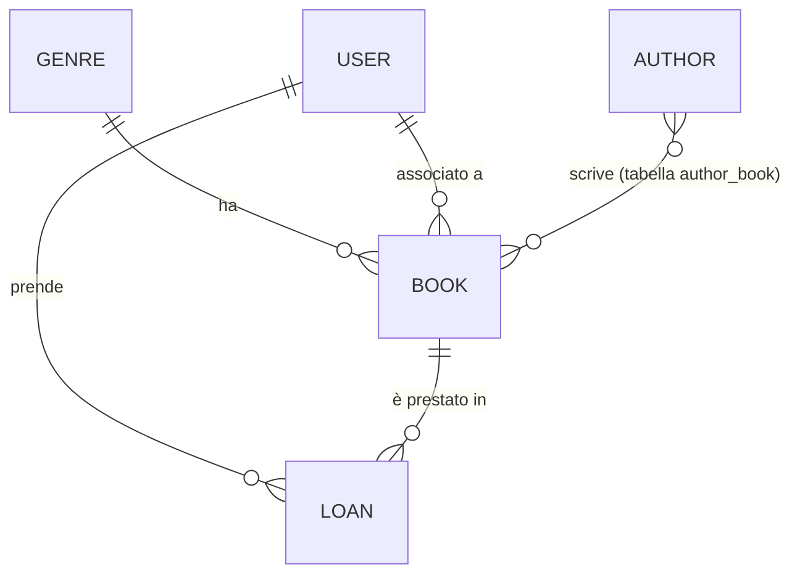

# Bookshelf

Applicazione web in **PHP e Laravel 13** per consultare un catalogo di libri con i loro autori e generi. Progetto sviluppato durante il corso *Sviluppatore Full Stack e AI System Integrator* per mettere in pratica l'architettura MVC e le relazioni tra tabelle con Eloquent ORM.

> **Stato del progetto:** in sviluppo. Al momento l'app è in sola lettura (elenco, dettaglio e ricerca). Le operazioni di creazione, modifica ed eliminazione sono previste nei prossimi passi.

## Funzionalità attuali

- Elenco dei libri con **ricerca** per titolo o cognome dell'autore
- **Paginazione** (10 libri per pagina) che mantiene il termine cercato nei link
- Pagina di dettaglio del libro, con autori (collegati alle loro pagine), genere, anno, pagine, ISBN e chi lo ha inserito
- Elenco degli autori, ordinati per cognome, con il numero di libri di ciascuno
- Pagina di dettaglio dell'autore, con i suoi libri ordinati per anno di pubblicazione
- Risposta 404 automatica se il libro o l'autore richiesto non esiste

## Cosa ho messo in pratica

- Architettura **MVC**: route, controller, modelli e viste Blade con un layout riutilizzabile (componente `x-layout`)
- Output delle viste sempre escapato con `{{ }}` (protezione da XSS)
- Vista di **paginazione personalizzata** in HTML semplice
- **Relazioni Eloquent**: uno-a-molti (genere → libri), molti-a-molti (autori ↔ libri) e appartenenza a un utente
- **Eager loading** (`with`, `load`, `withCount`) per evitare il problema delle query N+1
- **Query scope** (ricerca per titolo/autore, libri pubblicati in un intervallo di anni, autori italiani)
- **Accessor** (`full_name` dell'autore, `is_long` per i libri oltre 400 pagine) e **cast** dei campi
- **Route model binding** e protezione dal mass assignment con `#[Fillable]`
- **Migrazioni** con chiavi esterne (`nullOnDelete`, `cascadeOnDelete`, `restrictOnDelete`), indici, vincoli di unicità e chiave primaria composta nella tabella pivot
- **Seeder e factory** per popolare il database con dati reali e dati di prova
- Modello `Loan` per i prestiti (non ancora collegato all'interfaccia)

## Tecnologie

PHP · Laravel 13 · MariaDB · Eloquent ORM · Blade (componenti) · Composer · Vite · PHPUnit · Git/GitHub

## Struttura del database



| Tabella | Campi principali |
| --- | --- |
| `books` | title, isbn (univoco), year, pages, cover_path, genre_id, user_id |
| `authors` | first_name, last_name, nationality, birth_year |
| `genres` | name |
| `author_book` | tabella pivot tra autori e libri |
| `loans` | user_id, book_id, loaned_at, returned_at |
| `users` | name, email (univoco), password (tabella standard di Laravel) |

Chiavi esterne: se un genere o un utente viene eliminato, nei libri il campo diventa `NULL`; eliminando un libro o un autore si eliminano le righe della tabella pivot; un libro con prestiti non può essere eliminato.

## Rotte disponibili

| Metodo | URL | Descrizione |
| --- | --- | --- |
| GET | `/` | Reindirizza all'elenco dei libri |
| GET | `/books` | Elenco libri (con `?q=` per la ricerca) |
| GET | `/books/{book}` | Dettaglio libro |
| GET | `/authors` | Elenco autori |
| GET | `/authors/{author}` | Dettaglio autore |

## Come avviarlo in locale

Servono PHP, Composer, Node.js e un server MariaDB.

```bash
git clone https://github.com/FedericoB-stack/CorsoFullStack-Bookshelf.git
cd CorsoFullStack-Bookshelf

composer install
npm install

cp .env.example .env
php artisan key:generate
```

Crea un database vuoto in MariaDB (ad esempio `bookshelf`) e imposta i dati di connessione nel file `.env`:

```env
DB_CONNECTION=mariadb
DB_HOST=127.0.0.1
DB_PORT=3306
DB_DATABASE=bookshelf
DB_USERNAME=il_tuo_utente
DB_PASSWORD=la_tua_password
```

Poi esegui le migrazioni e avvia il server:

```bash
php artisan migrate --seed
php artisan serve
```

Il seeder crea un utente di prova (`demo@example.com`, password `password`), 5 generi, 9 autori e 15 libri reali, più alcuni dati generati dalle factory per vedere la paginazione. Per ricreare il database da zero: `php artisan migrate:fresh --seed`.

L'app sarà disponibile su `http://127.0.0.1:8000`.

## Prossimi passi

- [ ] Creazione, modifica ed eliminazione dei libri (CRUD completo)
- [ ] Validazione dei dati dei form
- [ ] Autenticazione degli utenti
- [ ] Upload della copertina del libro
- [ ] Gestione dei prestiti tramite il modello `Loan`

## Autore

Federico Balducci · [GitHub](https://github.com/FedericoB-stack)
